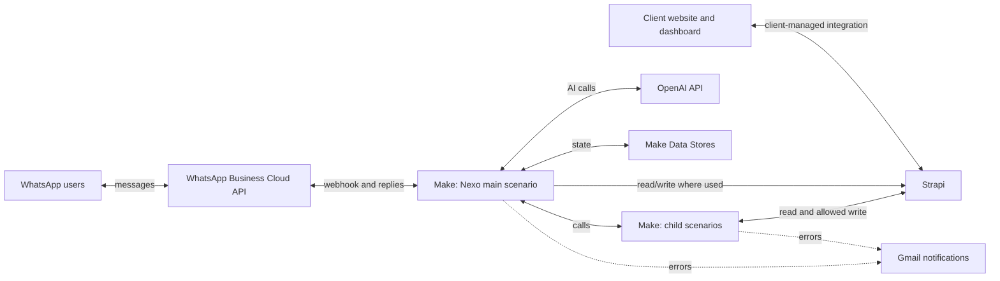

# 01 — System Map

## Executive summary

Nexo is a production WhatsApp assistant orchestrated through **multiple Make.com scenarios** in Llegando al Country's account. It uses **WhatsApp Business Cloud API** for messages, **OpenAI API** for AI processing, **Strapi** for operational records and listings, **Make Data Stores** for supporting state, and **Gmail** for technical error alerts. The client's website and analytics/messages dashboard are developed and operated separately by the client, reading data from Strapi.

## Architecture overview

- **Communication:** `SYS-LTC-003` WhatsApp API ⇄ `SYS-LTC-001` Make main webhook/scenarios.
- **Processing:** `SYS-LTC-001` Make calls `SYS-LTC-004` OpenAI API and child scenarios (exact processing by route not fully documented yet).
- **Persistent domain data:** `SYS-LTC-002` Strapi; Firbot writes/updates recommendation and WhatsApp logging entities as necessary, but **only reads** published ads.
- **Transient/workflow state:** Make Data Stores `DATA-LTC-005`–`DATA-LTC-013`.
- **Operational alerts:** `SYS-LTC-005` Gmail error notifications, using a child scenario indicated by the blueprint.
- **Presentation / business operations:** `SYS-LTC-006` client-managed web application/dashboard, using Strapi.

## Diagram (logical, not a verified network topology)

**Diagram caveat:** Direct versus child-initiated Strapi access and error notifications are schematic. Per-module routes and exact connections must be verified using all productive blueprints; the provided main export is not a full end-to-end snapshot.

## Sources of truth

| Data domain | Current candidate | Verification |
|---|---|---|
| Published service ads | Strapi: `LL - Anuncios` | Confirmed from user-supplied Strapi screenshots and stakeholder |
| Recommendations | Strapi: `LL - Recomendaciones de servicios` | Confirmed from user-supplied screenshots and stakeholder |
| WhatsApp conversation records | Strapi: `LL - WhatsApp Conversación` | Confirmed from user-supplied screenshots; exact completeness TODO |
| WhatsApp message records | Strapi: `LL - WhatsApp Mensaje` | Confirmed from user-supplied screenshots; exact completeness TODO |
| Ephemeral user processing / helpers | Make Data Stores | Screenshot confirmed stores exist; exact usage by scenario TODO |
| Analytics displayed in client's dashboard | Strapi-backed | Confirmed by stakeholder; implementation TODO |

## Main flows

1. **General inbound:** WhatsApp sends a new message to Make's main webhook. The main scenario routes according to message kind, conversation state and special interactions, and may call child scenarios.
2. **Search:** Main export references separate search-by-zone, search-by-category and service-by-zone subscenarios; published ads are used as read-only business data.
3. **Recommendations:** User sends a recommendation; Nexo's recommendation child and related flows interact with Strapi. A separate child route handles multiple contacts/recommendations.
4. **Message logging:** A Make child `LL - Log Message` receives structured entry/exit log payloads; Strapi WhatsApp message/conversation collections are present.
5. **Failures:** Error-handling paths invoke a notification subscenario; Gmail is the stated error communication channel.

## Lifecycle and ownership

- **Current:** production Nexo, Make orchestrations, Strapi, WhatsApp Cloud API, OpenAI API, Gmail technical alerts.
- **Not deployed/confirmed:** a separate testing environment, a formal paid maintenance contract.
- **TODO:** verify change control, incident escalation, restore/replay strategy and permissions.

## Sources

- Stakeholder onboarding conversation, 2026-11-22.
- User-supplied Strapi UI screenshots, 2026-11-22 (not stored in Git).
- User-supplied Make Data Stores screenshot, 2026-11-22 (not stored in Git).
- Inspected *LL - Chatbot Recomendacion de Servicios* main blueprint, provided 2026-11-22 (original excluded due to embedded secrets).
