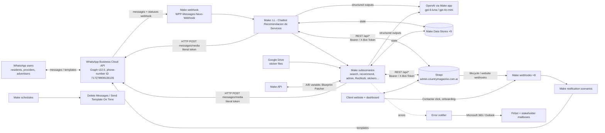

# 01 — System Map

## Executive summary

Nexo runs as **37 Make scenarios (29 active)** in the client-owned Make organization `Llegando al Country` (4655020, team 1163364, zone us2). Three families of automation exist:

1. **Conversational bot** — one webhook-triggered main scenario (2505419) receiving WhatsApp Cloud API events, orchestrating 17 on-demand subscenarios, OpenAI structured-output calls and Make Data Stores, and reading/writing Strapi.
2. **Platform-triggered notifications** — 8 scenarios triggered by webhooks from the client platform (Strapi lifecycle events / website: new recommendation, ad published, new review, 20 visits, "Contactar" click, onboarding days) that send WhatsApp **templates** to providers, advertisers and users.
3. **Scheduled housekeeping** — history purge (every 2 h) and off-hours template replay (10:00/18:00).

Shared services: `LL - Log Message` (Strapi message log), `Envio de Notificaciones de Error Chatbots` (Outlook e-mail alerts).

## Architecture diagram

Hosts: `graph.facebook.com`, `admin.countrymagazine.com.ar`, `hook.us2.make.com`, `countrymagazine.com.ar` (links only), Google Drive, Microsoft Graph (via Make app), OpenAI (via Make app), Make API.

## Main flows

| Flow | Path | Doc |
|---|---|---|
| Greeting | First text → greeting + Welcome sticker + 3 buttons | [main](automations/make/ll-chatbot-recomendacion-de-servicios.md) |
| Search | AI intent → Buscar Zona → Buscar Categoría → Buscar Servicio por Zona (reads `/api/servicios`) | [search](automations/make/ll-search-subscenarios.md) |
| Single recommendation | AI slots complete → zone/category resolution → Recomendar Servicio (POST/PUT `recomendaciones-servicios`) → Strapi webhook → provider template + coupon | [recommend](automations/make/ll-recomendar-servicio.md), [outbound](automations/make/ll-outbound-notifications.md) |
| Multiple recommendation | ≥2 contacts → RecMulti 1→2→5→4 with tray in `LL_MultiRecBatch` | [RecMulti](automations/make/ll-recmulti-recomendacion-multiple.md) |
| Publish / magazine / FAQ | AI intent → static texts / Special Interaction / FAQ prompt | [main](automations/make/ll-chatbot-recomendacion-de-servicios.md) |
| Review request | Website "Contactar" → Pedido Review template → answer handled by Special Interaction | [review](automations/make/ll-special-interaction-and-review.md) |
| Advertiser lifecycle | Strapi events → Anuncio Publicado / Opinión / Visitas / Onboarding 2–4 templates | [outbound](automations/make/ll-outbound-notifications.md) |
| Admin welcome campaign | `#adminmode` (allow-list) → queue contacts → send template | [admin](automations/make/ll-admin-mode-and-welcome.md) |
| Logging | Every message → Log Message → `POST /api/wpp-bot/mensajes`; read receipts → PUT `vistoEn` | [utilities](automations/make/shared-utility-subscenarios.md) |
| Errors | onerror → error notifier → Outlook e-mail (+ optional WA apology) | [utilities](automations/make/shared-utility-subscenarios.md) |

## Sources of truth

| Domain | System of record | Make copy / cache |
|---|---|---|
| Ads | Strapi `servicios` (read-only for Make) | none |
| Recommendations | Strapi `recomendaciones-servicios` | `LL_RecommendationsMade` (contacted flag), `LL_MultiRecBatch` (pending) |
| Messages / conversations | Strapi `wpp-mensajes` / conversations (via custom endpoint) | `LL_MessagesHistory` (≤10 recent, short-lived) |
| Admin permissions | Make `LL_PermissionsList` | — |
| Review requests | Make `LL_ReviewRequests` | — |
| Dashboard statistics | Strapi (client dashboard) | — |

## Lifecycle and ownership

- Production only; no test environment (confirmed — development runs observed in production on 2026-11-05).
- Client owns Make account, Strapi, website, Google Drive; Firbot maintains Make scenarios; error-mail connection belongs to a Firbot individual.
- Meta app/WABA ownership, OpenAI account ownership: **Unknown**.

## Sources

Make API read-only inventory 2026-11-22 (scenarios, blueprints, hooks, connections, data stores, data structures, executions); onboarding stakeholder conversation and screenshots 2026-11-22.
