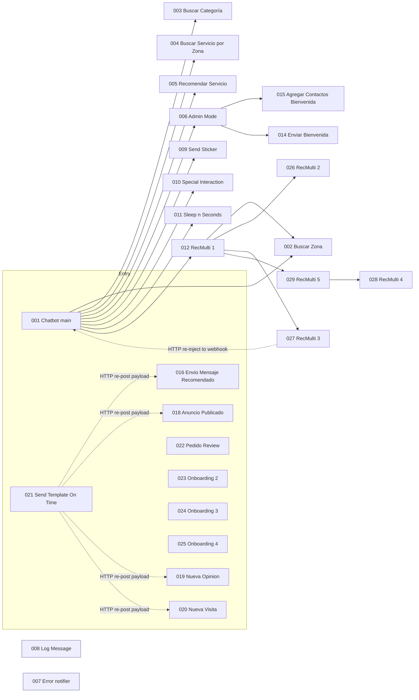

# Make automations — Llegando al Country

Organization `Llegando al Country` (4655020) · team `My Team` (1163364) · zone `us2.make.com` · plan Pro (120,000 ops, 30-day log retention) · **no folders, no scenario labels**. Account user: client-owned Make user (identity not recorded here).

**Inventory (2026-11-22): 37 scenarios — 29 active, 8 inactive.**

## Detail documents

| Document | Covers |
|---|---|
| [ll-chatbot-recomendacion-de-servicios.md](ll-chatbot-recomendacion-de-servicios.md) | AUTO-LTC-001 main scenario |
| [ll-search-subscenarios.md](ll-search-subscenarios.md) | AUTO-LTC-002, 003, 004 |
| [ll-recomendar-servicio.md](ll-recomendar-servicio.md) | AUTO-LTC-005 |
| [ll-admin-mode-and-welcome.md](ll-admin-mode-and-welcome.md) | AUTO-LTC-006, 014, 015 |
| [shared-utility-subscenarios.md](shared-utility-subscenarios.md) | AUTO-LTC-007, 008, 009, 011 |
| [ll-special-interaction-and-review.md](ll-special-interaction-and-review.md) | AUTO-LTC-010, 022 |
| [ll-recmulti-recomendacion-multiple.md](ll-recmulti-recomendacion-multiple.md) | AUTO-LTC-012, 026, 027, 028, 029 |
| [ll-outbound-notifications.md](ll-outbound-notifications.md) | AUTO-LTC-016–021, 023–025 |
| [housekeeping-and-firbot-tooling.md](housekeeping-and-firbot-tooling.md) | AUTO-LTC-013, 030–037 |

## Classification

| Class | Scenarios |
|---|---|
| **Entry point — WhatsApp webhook** | 001 main |
| **Entry points — client-platform webhooks** | 016, 018, 019, 020, 022, 023, 024, 025 |
| **Scheduled** | 013 Delete Messages (2 h), 021 Send Template On Time (10:00/18:00) — 030 inactive |
| **Subscenarios (on-demand, called)** | 002–012, 014, 015, 026–029 |
| **Shared services** | 007 error notifier (23 callers), 008 logger (20 callers), 002 Buscar Zona (2 callers) |
| **Orphan / never called but active** | 017 Envio de Mensaje Recomendados Previos |
| **Inactive legacy / test** | 030, 031 |
| **Inactive Firbot dev tooling** | 032–037 |

## Call graph (CallSubscenario edges, verified)

Not drawn for readability: **`008 LL - Log Message`** is called by 001, 003, 004, 005, 006, 009, 010, 014, 016, 018, 019, 020, 022, 023, 024, 025, 026, 027, 029, 012; **`007 Envio de Notificaciones de Error Chatbots`** is called by all of those plus 002, 021 and 008 itself.

## Webhooks (17 in team)

| Hook ID | Name | Type | Bound scenario | Notes |
|---|---|---|---|---|
| 2623296 | WPP-Messages-Nexo-Webhook | custom | 001 (active) | No API-key auth; receives Meta webhooks (Inference) |
| 1925734 | Creacion-Recomendado-Strapi | custom | 016 | |
| 1999490 | Codigo-Verificacion-WPP-Strapi | custom | 018 | Name does not match purpose (ad published) |
| 2039466 | NewPostOpinionStrapi | custom | 019 | |
| 2039478 | NewPostVisitStrapi | custom | 020 | |
| 2560154 | Boton-Contactar | custom | 022 | |
| 2642230 / 2642233 / 2642237 | Onboarding-Paso-02/03/04 | custom | 023 / 024 / 025 | |
| 2642224 | Onboarding-Paso-01 | custom | **none** | Unused |
| 1925920 | CreacionRecomendadoStrapiv2 | custom | **none** | Unused (superseded?) |
| 2527022 | Message Seen-webhook | custom | **none** | Unused (read receipts now handled in 001) |
| 1108615 | CountryMagazine ID WebHook v1 | WhatsApp Business Cloud (app) | **none** | Uses connection 4524873, which is **not in the team connection list** |
| 1276003 / 1276360 / 1281877 | My WhatsApp Business Cloud Events webhook | WhatsApp Business Cloud (app) | **none** | Unused, trivial verify tokens |

All hooks `enabled=true`, queue 0/667 at inspection. Hook URLs are bearer-like secrets and are not reproduced.

## Connections (5)

| ID | Name | App | Used by |
|---|---|---|---|
| 4527306 | My OpenAI connection | OpenAI | 001, 002, 003, 006, 014, 016, 022, 012, 036 |
| 5431897 | LMelman Firbot Connection | Microsoft 365 (azure) — owned by an individual Firbot account | 007 (all error e-mails) |
| 9967715 | My Google Drive connection | Google Drive (client account, expires 2027-05-19) | 009 |
| 9953737 | My Make (API key) connection | Make (OAuth2, expires 2027-05-20) | 016 (A/B variable update) |
| 12169302 | Firbot - Make API escenarios | Make (API key) | 032 Blueprint Patcher |

WhatsApp and Strapi are **not** accessed through Make connections but via raw HTTP modules with literal tokens (older scenarios) or team variables (RecMulti, Firbot tools). Team custom variables observed in blueprints: `LL_WA_TOKEN`, `LL_STRAPI_TOKEN`, `ABTesting` (values not read). Make keychain keys: none.
