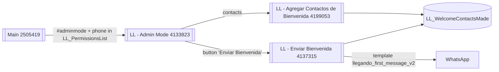

# Admin Mode and welcome-message campaign

## AUTO-LTC-006 — `LL - Admin Mode` (4133823)

- **Status:** active, on-demand; created 2026-02-13, last edit 2026-11-06. Called by the main scenario (route *Admin Mode* and when the user's history has `Admin_Mode=true`).
- **Inputs:** `PhoneNumber`, `ContactName`, `CurrentMessageText`, `CurrentMessageType`, `CurrentMessageTimestamp`, `CurrentInteractionOption`, `ContactsArray`, `ClaveExternaEntry`.
- **Logic:** `#adminmode` → clears the user's history, sends welcome-admin interactive menu, logs with `AdminMode=true` (the stored `Admin_Mode` flag is what keeps subsequent messages routed here). Later messages: `Salir`/"Salir de Admin Mode" → clear history, exit message. Otherwise OpenAI `Data Extractor` (`gpt-6-luna`, outputs `whatUserNeed`, `contactsSent`): `Bienvenida` → if contact cards → `LL - Agregar Contactos de Bienvenida`; if text → OpenAI `Contact Parser` (`isContacts`, `parsedContacts`) → same subscenario; button `Enviar Bienvenida` → `LL - Enviar Bienvenida` and report results. Long contact lists are split in two WA messages (1,024-char limit).
- **Data:** `LL_MessagesHistory` (R/C/D). No Strapi access. 21 orphan modules remain in the canvas (dead design).
- **Risk:** any number in `LL_PermissionsList` can trigger bulk template sends.

## AUTO-LTC-015 — `LL - Agregar Contactos de Bienvenida` (4199053)

Input `contactsArray` (WhatsApp contact objects). For each contact: if a record with same `Phone Number` and `Contact Done=true` exists → "❌ ya contactado"; else if not present → `AddRecord` (`Contact Done=false`). Returns `addedContacts` text summary. Active, on-demand, created/last edit 2026-02-21.

## AUTO-LTC-014 — `LL - Enviar Bienvenida` (4137315)

No inputs. Searches `LL_WelcomeContactsMade` where `Contact Done ≠ true`; for each: OpenAI `Name Extractor` (`gpt-4o-mini`, `extractedName`) → WA template **`llegando_first_message_v2`** (language code `en`) → log → update `Contact Done=true`, timestamp. Returns `ContactStatus`, `ContactResults`. Active, on-demand; last edit 2026-06-20. Orphan modules include a native WhatsApp `sendTemplateMessage` and a router referencing `LL_OffTimeRecomendations` (not executed). Error → e-mail + Ignore (record stays pending → re-sent on next campaign run).
