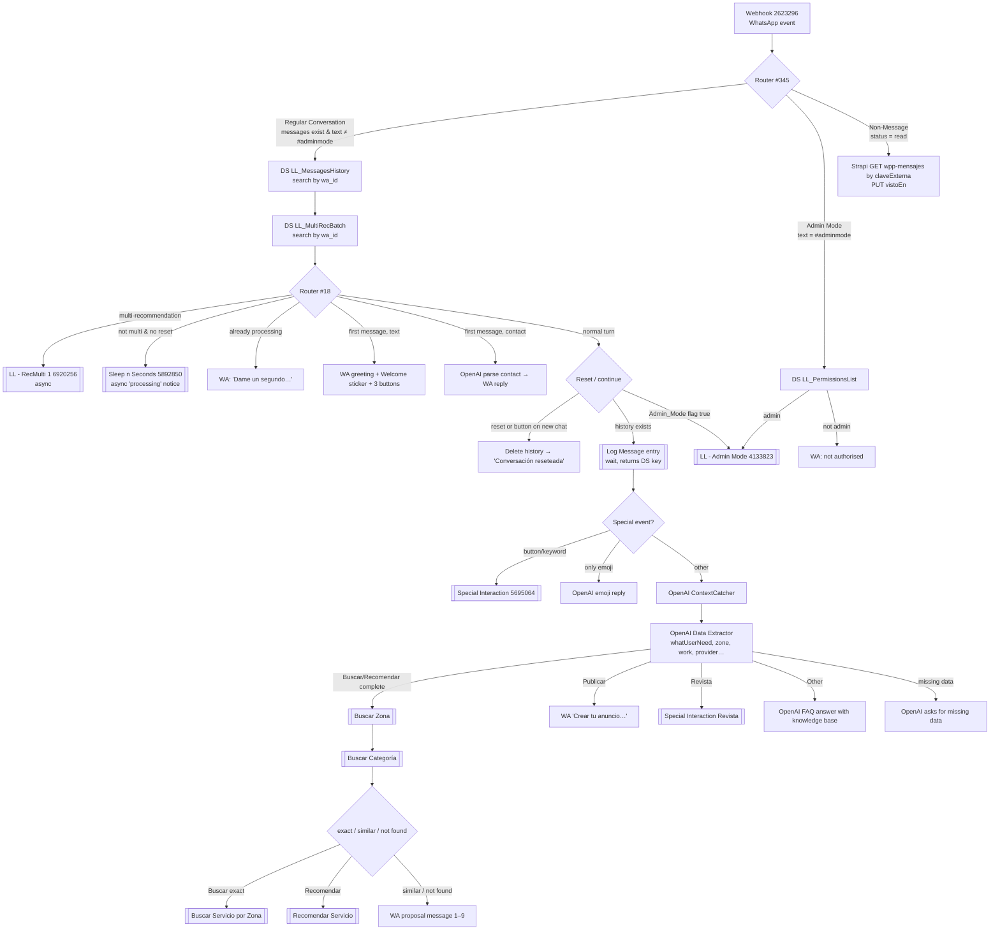

# AUTO-LTC-001 — `LL - Chatbot Recomendacion de Servicios`

## Summary

| Attribute | Value |
|---|---|
| Make scenario ID | `2505419` (team `1163364`, org `4655020`, no folder) |
| Status | **Active** (`isActive=true`, not paused) — confirmed live 2026-11-22 |
| Created / last edited | 2025-07-21 / 2026-11-06 |
| Trigger | Custom webhook `WPP-Messages-Nexo-Webhook` (hook ID `2623296`, type `gateway-webhook`, module `gateway:CustomWebHook` #575, `maxResults=1`) |
| Scheduling | `immediately`, max 100 runs/min, parallel (sequential=false) |
| Settings | DLQ (incomplete executions) **enabled**, maxErrors 3, autoCommit |
| Chaining role | parent (calls 13 distinct subscenarios) |
| Business purpose | Inbound WhatsApp message orchestration for Nexo: greeting, search, recommendation, publish info, magazine, special buttons, admin mode, read receipts |
| Criticality | Critical |

**Webhook origin (Inference):** the Meta WhatsApp Cloud API app is configured to POST its `messages` webhook to this Make custom webhook. The hook has **no API-key / signature verification** configured (`apikey: []`). The Meta app configuration itself was not inspected.

## High-level flow

## Detailed logic

### Route 1 — Regular Conversation (`#29 → #18`)

1. `#29` search `LL_MessagesHistory` by `Cellphone_Number = wa_id` → aggregated (`#56`); `#442` takes the record with `Is Currently Processing = true` first.
2. `#700` search `LL_MultiRecBatch` by `wa_id`.
3. Router `#18` (filters are evaluated on the same compound "is multi-recommendation" expression):
   - **Multi-recommendation** (≥2 contacts in one message, or button id starting with `mrec_`, or an active tray updated < 2 h ago and message type in text/interactive/button/contacts, and not admin) → `#705` contacts → JSON, `#701` call `LL - RecMulti 1 Recibir mensaje` (**async**, `TestMode=false`). On error → error e-mail + Ignore.
   - **Not multi & text not containing "reset"** → `#625` call `Sleep n Seconds` (async, 8 s) which sends a random "un segundo…" message only if the bot has not replied in the meantime.
   - **More Than 1 Message** (a previous message still flagged processing) → WA text "Dame un segundo. Estoy procesando tu mensaje anterior 🧠" + log.
   - **Conversation Starting** (no history, type text, not processing) → greeting "Hola {name} 👋 Soy Nexo…", sticker `Welcome` (`LL - Subscenario Send Sticker`, wait), interactive buttons `Buscar un Servicio` / `Recomendar Servicio` / `Publicar tu servicio`, then logs entry/exit messages.
   - **isContacts** (first message is a contact card) → OpenAI `Get Variables From Contact` (Name/Job/Zone) → explanatory WA message.
   - **Check If Doble Message** (not processing) → `#247` `NeedReset` = text contains "reset" or message is a button/interactive; router `#246`:
     - *Reset True* → delete all history records of the user; if text contains "reset" send "Conversación reseteada correctamente".
     - *userFound Or Contact Recomended* (history ≥1 and no reset, or specific menu buttons) → `#364`:
       - *Regular (Admin_Mode ≠ true)*: `#92` serialises contacts as `El contacto es = <name>+<phone>`; `#485` call `LL - Log Message` (**wait**, `SaveInDataStore=true`, `CurrentlyProcessing=true`) → returns `DataStoreKey` used later to clear the processing flag; `#51` reload history; `#229`:
         - `#48` aggregates transcript `"<ts> - Usuario:/Chatbot: <msg>"`.
         - **Special event** (`#608` maps button texts/keywords → `CompartirAnuncio`, `Revista`, `EditarMiAnuncio`, `DejarOpinion`, `QueEsLlegando`, `CuantoCuesta`, `Contactar` (review answers), `AnunciarServicio` …) → `LL - Subscenario Special Interaction` (wait).
         - **Only emoji** → OpenAI `Analyse Emoji` → WA reply with same number of emojis.
         - **Otherwise** → OpenAI `ContextCatcher` (`contextSummary`) → OpenAI `Data Extractor` (`whatUserNeed` ∈ Buscar/Recomendar/Publicar/Revista/Other, `zone`, `work`, `providerContact`, `providerName`, `proposalService`, `proposalZone`) → routes:
           - *Responder* (data complete): Publicar → fixed WA text; Buscar/Recomendar → sticker `Search` (async), `LL - Buscar Zona` (wait), `LL - Buscar Categoría` (wait, `EsBuscar`), then exact-match → `LL - Buscar Servicio por Zona` or `LL - Recomendar Servicio` (`isExact`); similar/not-found → one of 9 pre-written proposal messages (`ProposalGPTPromptNumber`); `AnunciosSimilares` → list of similar ads + buttons; after a recommendation with exact zone → upsert `LL_Users` (remember neighbourhood). Revista → Special Interaction (`Revista`). Other → OpenAI `Buscar informacion para responder a la pregunta` with an embedded business knowledge base ("General Llegando Database") → WA reply with/without buttons (`Again`).
           - *Preguntar* (data missing) → OpenAI `Search Information to Ask` → WA question.
           - *FinishConversation* (text contains reset) → delete history.
           - *No Data By GPT* → WA "Parece que tuve un problema…".
         - **LimitReached** (≥ 11 history records) → delete the oldest record.
       - *Admin Mode flag* → `LL - Admin Mode` (wait).
   - After each branch the user record is overwritten with `Is Currently Processing = false` (`CambiarElMensajeDeUsuarioANotProcessing`, key from `#485`), including inside most error handlers.

### Route 2 — Admin Mode (`#361`)
Text `#adminmode` → lookup `LL_PermissionsList` by phone; admin → `LL - Admin Mode` (wait); non-admin → WA "no estás autorizado…" + log.

### Route 3 — Non-Message (`#584`)
WhatsApp status callback with `status = read` → `GET /api/wpp-mensajes?filters[claveExterna][$eq]=<id>` → if found `PUT /api/wpp-mensajes/{id}` `vistoEn` (UTC). Errors → Ignore / e-mail.

## AI configuration

All OpenAI modules use `openai-gpt-3:transformTextToStructuredData` with connection `My OpenAI connection` (4527306) and model value **`gpt-6-luna`** (exact configured value; not independently verified against the OpenAI account).

| Module | Purpose | Output fields | Prompt size |
|---|---|---|---|
| #238 Get Variables From Contact | Split contact card name into name/job/zone | `Name`, `Job`, `Zone` | ~0.4 k chars |
| #288 ContextCatcher | Summarise conversation state | `contextSummary` | ~4.4 k |
| #180 Data Extractor | Intent + slot extraction | `whatUserNeed`, `zone`, `work`, `providerContact`, `providerName`, `proposalService`, `proposalZone` | ~6.1 k |
| #181 Search Information to Ask | Ask for the one missing slot | `newMessage` | ~6.6 k |
| #387 Buscar informacion… | FAQ answer using embedded knowledge base | `NewMessage`, `Again` (bool) | ~7.3 k + knowledge text |
| #650 Analyse Emoji | Emoji-only reply | `NewMessage` | ~0.8 k |

Prompts are in Spanish and stored in the sanitized export. Inputs include the last ≤10 messages of the user (personal data is sent to OpenAI).

## Concurrency, deduplication, idempotency

- **Processing lock:** soft lock via `Is Currently Processing` in `LL_MessagesHistory`; not atomic (parallel executions allowed, so two messages arriving at the same time can both pass) — **Inference**.
- **Double-message guard:** "More Than 1 Message" branch answers a holding message instead of processing.
- **History cap:** ~10 records/user; `Delete Messages` (AUTO-LTC-013) purges stale records every 2 h.
- **No idempotency on webhook replays:** a re-delivered Meta webhook is processed again; Strapi logging is idempotent only if the server dedups on `claveExterna` (**Unknown**).

## Error handling

- 24 calls to `Envio de Notificaciones de Error Chatbots` (AUTO-LTC-007) in `onerror` handlers, followed by `Ignore`/`Resume`; most also reset the processing flag.
- OpenAI ContextCatcher / Data Extractor: `Break` with automatic retry 3× every 1 min (DLQ enabled).
- Recipients/CC are hard-coded e-mail addresses in each handler (personal addresses; redacted in exports).
- Execution history (30-day retention): 1 failed execution on 2026-11-05 (during the RecMulti rollout); no other failures in the retention window.

## External integrations

| System | Endpoint / resource | Auth |
|---|---|---|
| WhatsApp Cloud API | `POST graph.facebook.com/v22.0/717278908136135/messages` (phone-number ID `717278908136135`) | **Literal Bearer token in 14 HTTP modules** |
| Strapi | `GET/PUT /api/wpp-mensajes` | **Literal Strapi Bearer token** |
| OpenAI | Make OpenAI app | Connection 4527306 |
| Make Data Stores | `LL_MessagesHistory`, `LL_MultiRecBatch`, `LL_PermissionsList`, `LL_Users` | — |

## Subscenario calls (verified)

| Called scenario | ID | Wait | Count |
|---|---|---|---|
| Envio de Notificaciones de Error Chatbots | 4226818 | yes | 24 |
| LL - Log Message | 5421473 | no ×14 / yes ×3 | 17 |
| LL - Recomendar Servicio | 2637777 | yes | 3 |
| LL - Admin Mode | 4133823 | yes | 2 |
| LL - Subscenario Send Sticker | 5694920 | yes ×1 / no ×1 | 2 |
| LL - Subscenario Special Interaction | 5695064 | yes ×1 / no ×1 | 2 |
| LL - Buscar Zona / Buscar Categoría / Buscar Servicio por Zona | 2637689 / 2637692 / 2637743 | yes | 1 each |
| Sleep n Seconds | 5892850 | no | 1 |
| LL - RecMulti 1 Recibir mensaje | 6920256 | no | 1 |

All targets are **active** (verified 2026-11-22).

## Known issues and risks (from configuration)

- **FIND-LTC-001** literal WhatsApp and Strapi tokens in modules.
- **FIND-LTC-009** call `#567` to Special Interaction (Revista path) maps the input as `WichSpecialEvent` (typo) instead of the required `WhichSpecialEvent` → the event is not passed; the subscenario's `Revista` route would not match (**Inference** — verify with an execution log). The keyword path (`#609`, text contains "revista") uses the correct key.
- Webhook without authentication (FIND-LTC-005).
- Lock not atomic; personal data sent to OpenAI; error recipients hard-coded.

## Recovery (verified mechanisms only)

- DLQ is enabled: failed executions with retry/Break land in *Incomplete executions* and can be resolved/replayed from the Make UI (replay re-sends real WhatsApp messages — production impact).
- A user stuck "processing" can be released by sending `reset` (deletes history) or waiting for `Delete Messages` (≤2 h + 3 h age).

## Related

[Automation registry](../../03_AUTOMATION_REGISTRY.md) · [Call graph](README.md) · [LL_MessagesHistory](../../schemas/make/ll-messageshistory.md) · [Security notes](../../../docs/SECURITY_NOTES.md)
