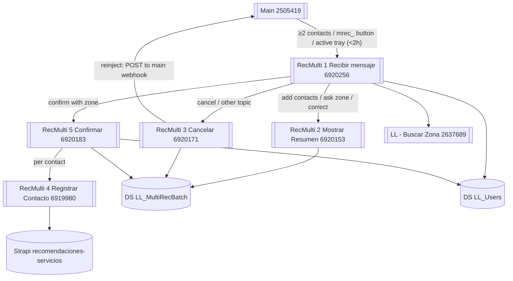

# Multiple recommendation — RecMulti family

Introduced 2026-11-05 (all five created that day; RecMulti 1 last edited 2026-11-20). All **active**, on-demand. The provisional registry entry `AUTO-LTC-012` ("Recomendación múltiple", `SCN_6920256`) is reconciled to **`LL - RecMulti 1 Recibir mensaje`**.

Design differences from older scenarios: credentials via **team variables** `LL_WA_TOKEN` / `LL_STRAPI_TOKEN` (no literals), `TestMode` input throughout (no WA sends / no Strapi writes when true), RecMulti 1 runs **sequentially** (`sequential=true`).

## AUTO-LTC-012 — `LL - RecMulti 1 Recibir mensaje` (6920256)

- **Inputs:** `wa_id`, `user_name`, `msg_type`, `msg_text`, `button_id`, `button_title`, `message_id`, `timestamp`, `contacts_json`, `TestMode`.
- Reads tray (`LL_MultiRecBatch`) and remembered zone (`LL_Users`); computes `mode` (`add`, `confirm`, `askzone`, `cancel`, `foreign`, `text`) and whether the tray is active (updated < 2 h).
- `add`: merge new contacts with pending list, OpenAI `IA: separar nombre y servicio` (`gpt-6-luna`; `nombres`, `servicios`, `barrio`), cap at **10 contacts**, resolve zone via `LL - Buscar Zona`, show summary (RecMulti 2).
- Buttons: `mrec_ok` → confirm (RecMulti 5 if zone known, else ask zone), `mrec_zone` → ask zone, `mrec_cancel` → RecMulti 3; another bot button while active → RecMulti 3 with `reinject=true`. Expired tray button → WA "lista vencida".
- Free text with active tray → OpenAI `IA: entender respuesta del usuario` (`accion` ∈ confirmar/cancelar/barrio/corregir/otro, `barrio`, `nombres`, `servicios`, `quitar`) → corresponding route.
- Execution history: 1 failed run on 2026-11-05 (`DataError` in a `map()` over an object) — triggered **via the Make MCP `scenarios_run` tool by a Claude client** during development (provenance recorded by Make).

## AUTO-LTC-026 — `LL - RecMulti 2 Mostrar Resumen` (6920153)

Inputs `wa_id`, `user_name`, `items_json`, `zone_name`, `status` (`await_zone`/`await_confirm`), `note`, `TestMode`, `created_at`. Builds numbered list, **upserts the tray** (key = `wa_id`), sends interactive buttons (✅ Sí, registrar / 📍 Cambiar barrio / ❌ Cancelar, or only Cancelar while waiting for zone), logs, returns `msg`.

## AUTO-LTC-027 — `LL - RecMulti 3 Cancelar` (6920171)

Inputs include `reinject`, `count` and the original message fields. Deletes the tray (test mode: marks `cancel_test`). `reinject=false` → cancellation message with menu buttons; `reinject=true` → "Dejé sin registrar…" and **re-posts a synthetic WhatsApp webhook payload to the main scenario's webhook URL** (hard-coded; `entry.id = reinyectado_recmulti`) so the user's new message is processed by the normal bot.

## AUTO-LTC-028 — `LL - RecMulti 4 Registrar Contacto` (6919980)

Inputs `nombre`, `telefono`, `servicio`, `zone_name`, `zone_id`, `user_name`, `user_wa_id`, `TestMode`; outputs `status` (`nueva`, `sumado`, `ya_recomendado`, `error`, `test_*`), `recId`, `catName`.
Search recommendation by last 10 phone digits → exists: append recommender to `Recomendadores` unless already present (idempotent per recommender) → else find category (`$startsWithi`/`$containsi`, top 3) and `POST` new recommendation with `barrioServicio`/`categoriaServicio` relations and `observacion = "Recomendación múltiple por WhatsApp…"`. `stopOnHttpError=false`; errors returned as status, no e-mail here.

## AUTO-LTC-029 — `LL - RecMulti 5 Confirmar` (6920183)

Resolve zone ID (`GET /api/barrios-agenda`), iterate contacts → RecMulti 4 (wait) → aggregate per-contact result lines → upsert `LL_Users` (remember zone) → delete tray → WA result with menu buttons → log (`SaveInDataStore=true`, wait) → **delete all older `LL_MessagesHistory` records of the user except the one just saved** → if any contact failed, error e-mail listing the user and zone.

## Risks

- Webhook re-injection relies on a hard-coded webhook URL; if the main webhook is regenerated, re-injection silently fails (`stopOnHttpError=false`).
- Team variables hold tokens in clear for any Make team member (better than literals, but not a vault).
- Tray expiry (2 h) is computed in each call; no scheduled cleanup of abandoned trays (they are overwritten/ignored when stale).
