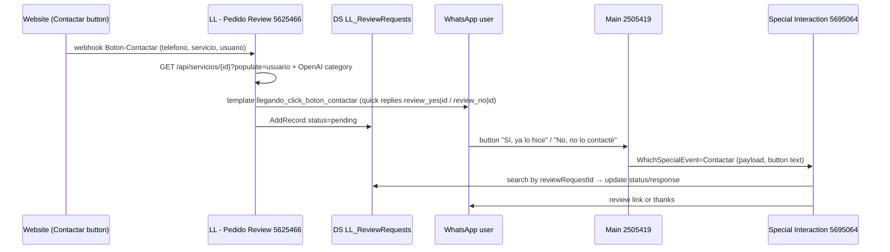

# Special Interaction and review-request flow

## AUTO-LTC-010 — `LL - Subscenario Special Interaction` (5695064)

- **Status:** active, on-demand; created 2026-07-18, last edit 2026-11-06. Caller: main scenario (2 call sites).
- **Inputs:** `WhichSpecialEvent`* ∈ {Contactar, CompartirAnuncio, Reset, Revista, DejarOpinion, EditarMiAnuncio, AnunciarServicio, CuantoCuesta, QueEsLlegando}, `wa_id`, `ContactName`, `NotGeneral` {ButtonPayload, ButtonText, ContactToText, DataStoreKey, DataStoreMessage, IncomingMessageID, MessageType, TimeStamp}.
- **Routes:** `CompartirAnuncio` (find ad by slug = button payload in `GET /api/servicios`, send copy-paste share text), `Revista` (subscription link), `DejarOpinion` (review link), `EditarMiAnuncio` (instructions), `Contactar` (review answer, updates `LL_ReviewRequests`), `AnunciarServicio`, `QueEsLlegando`, `CuantoCuesta` (static texts). Each route logs and resets the processing flag in `LL_MessagesHistory` (key `NotGeneral.DataStoreKey`).
- **Finding:** enum value `Reset` has **no route** (dead option). The main scenario's Revista call (#567) passes `WichSpecialEvent` (typo) — see FIND-LTC-009.
- Strapi: `GET /api/servicios` only (read-only).

## AUTO-LTC-022 — `LL - Pedido Review` (5625466)

- **Status:** active; webhook `Boton-Contactar` (hook 2560154), immediate, DLQ enabled; created 2026-07-10, last edit 2026-07-28.
- **Trigger payload:** `tipo`, `telefono`, `usuario{id,nombre}`, `servicio{id,nombre,slug,url}`, `contacto{tipo,fecha}`, `debug`.
- **Logic:** clean phone → `GET /api/servicios/{id}?populate=usuario` → OpenAI `Detect Category` (`gpt-4o-mini`, output `category`, prompt completes "¿Llegaste a contratarlo para [categoría]?") → `reviewRequestID = review_<serviceId>_<phone>_<unix ts>` → WA template **`llegando_click_boton_contactar`** with quick-reply payloads → `AddRecord` in `LL_ReviewRequests` (status `pending`) → log.
- **Errors:** Strapi/OpenAI → e-mail + `Break` retry 3×15 min; WA send → e-mail + Ignore.
- **Finding (FIND-LTC-010):** the log call (#18) uses **hard-coded test values** for `Nombre`, `Telefono` and the `slug`/`url` inside `Metadata` instead of the real recipient — every logged outbound message of this flow is attributed to the same fixed person in Strapi (`LL - WhatsApp Mensaje`).
- No timing window and no deduplication: every click sends a template.
