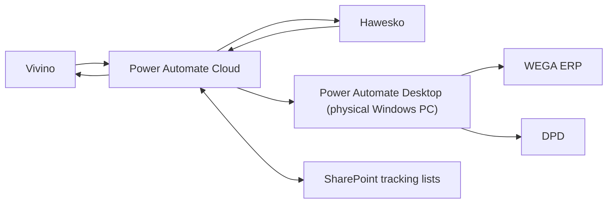

# System Map

## Executive summary

Weincenter Lörrach uses Power Automate Cloud and Power Automate Desktop to fulfil marketplace orders from Vivino and Hawesko. WEGA serves as the ERP for invoicing; DPD is used for shipping/tracking. SharePoint tracking lists store operational order state. Two order-delivery automations run in production according to the stakeholder; exports are needed to confirm implementation details.

## Layers

- Sales marketplaces: `SYS-ORD-001` Vivino; `SYS-ORD-002` Hawesko.
- Orchestration: `SYS-OPS-001` Power Automate Cloud; `SYS-OPS-002` Power Automate Desktop.
- ERP: `SYS-ERP-001` WEGA.
- Shipping: `SYS-SHP-001` DPD.
- Tracking/data: `SYS-DATA-001` Microsoft SharePoint; account/tenant: `SYS-IT-001` Microsoft 365.

## Current high-level flows

1. Orders are retrieved from the marketplace. Vivino retrieval and status updates use its API according to the **historical Vivino guide**, pp. 2-3; Hawesko method TODO: verify.
2. Cloud orchestration calls PAD flows to perform DPD shipment creation and WEGA invoicing (Vivino historical guide, pp. 2-3).
3. Shipment tracking and invoice number are recorded and order status is updated in the relevant marketplace/SharePoint list (user report + Vivino guide).
4. Vivino guide describes an end-of-day `Shipped` updater at 17:00 and bi-weekly SharePoint archival. Both require confirmation from the upcoming exports.

## Sources of truth (provisional)

| Data domain | Candidate source | Evidence / status |
|---|---|---|
| Marketplace orders | Vivino / Hawesko | Stakeholder-reported; TODO: verify authoritative fields |
| ERP invoices | WEGA | Stakeholder-reported; TODO: verify |
| Shipping labels and tracking | DPD | Stakeholder-reported; TODO: verify |
| Operational order workflow state | Platform-specific SharePoint tracking lists | Vivino described in historical guide pp. 6-8; Hawesko stakeholder-reported |

## Known conflicts and questions

- **Conflict — verification required:** stakeholder narrative mentioned WEGA then DPD; Vivino historical guide (p. 3) describes DPD then WEGA. Review actual execution order in current flows.
- **TODO: verify:** published guide describes hourly Vivino schedule, 17:00 Shipped process, bi-weekly backup cleanup; the stakeholder only confirms multiple daily executions, not exact clocks.
- **TODO: verify:** presence of external PAD attended RPA licensing, Power Automate environment IDs, connector ownership and machine IDs.

## Logical diagram (not a verified action-by-action flow)

## Proposed but not production

DPD API integration: idea under evaluation, awaiting client approval. Track in development backlog and `08_DECISION_REGISTRY.md`, never draw as a deployed connection.
